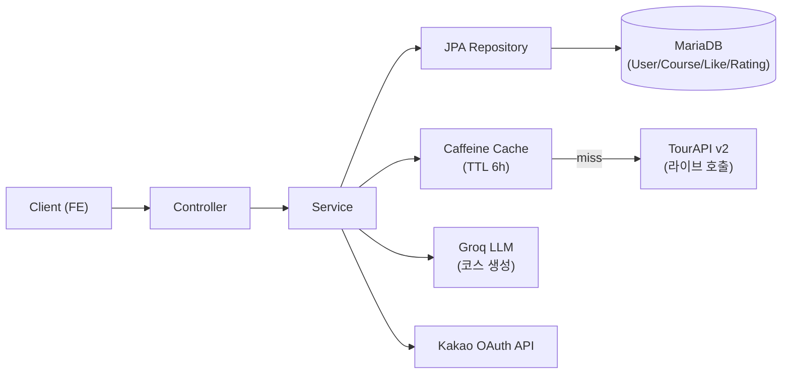
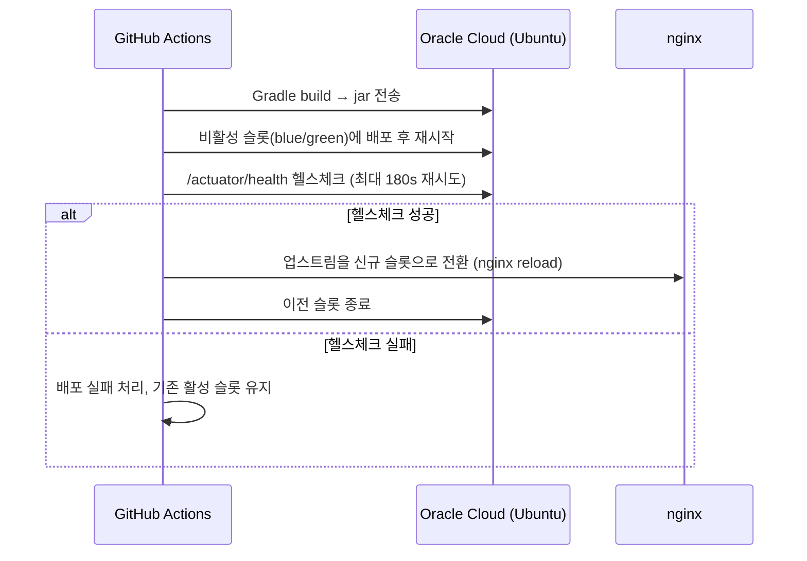

# 경북 CoCo — Backend

경북 지역 관광 정보를 바탕으로, 사용자 조건(인원·기간·테마·이동수단)에 맞는 여행 코스를 **AI(Groq LLM)가 자동으로 생성**해주는 여행 플래너 서비스입니다. 공모전 출품작으로, 백엔드 설계·개발·배포·운영을 담당했습니다.

- 프론트엔드: https://github.com/UsoD98/Gyeongbuk-CoCo
- 서비스 URL: https://gbcoco.netlify.app/

## 목차

- [트러블슈팅](#트러블슈팅)
- [기술 스택](#기술-스택)
- [아키텍처](#아키텍처)
- [핵심 기능](#핵심-기능)
- [배포](#배포)

## 트러블슈팅

### 1. [보안] 카카오 로그인 이메일 자동 연결 — 계정 탈취(인증 우회) 취약점

- **상황**: 카카오 로그인 시 카카오 프로필 이메일이 기존 로컬 가입 이메일과 **문자열만 일치**하면 소유권 확인 없이 바로 그 계정에 연결해 JWT를 발급하고 있었습니다.
- **원인 분석**: 카카오 API는 이메일이 인증되지 않은 상태에서도 `email` 필드 자체는 그대로 내려줍니다. 즉 공격자가 자기 카카오 계정에 피해자의 로컬 가입 이메일을 (인증 없이) 등록만 하고 로그인하면, 피해자와의 상호작용 없이 그 계정에 들어갈 수 있는 구조였습니다. 코드 리뷰 과정에서 카카오 응답에 `is_email_valid`/`is_email_verified` 플래그가 별도로 내려온다는 것을 확인했습니다.
- **해결**: 두 플래그가 모두 `true`인, 즉 카카오가 보증한 이메일일 때만 기존 계정 조회·연동을 시도하도록 변경했습니다. 신뢰할 수 없는 이메일은 조회 자체를 건너뛰고 합성 이메일(`kakao_{id}@kakao.local`)로 항상 별도 계정을 생성합니다. (이메일 미인증 상태로 가입한 정상 사용자는 계정이 분리되는 트레이드오프가 있으나, 보안을 우선해 의도적으로 감수했습니다.)
- **결과**: 인증 우회 경로를 제거하고, 성공/실패/공격 시나리오 테스트를 추가해 재발을 방지했습니다.

### 2. [장애 대응] 외부 API 무응답 시 요청이 멈춰 전체 504 장애로 전파

- **상황**: 배포 후 코스 생성 요청이 간헐적으로 응답 없이 멈추다 결국 프론트에서 504로 실패하는 장애가 발생했습니다.
- **원인 분석**: 로그가 `"Fetching places data..."` 한 줄에서 끊긴 채 더 이상 찍히지 않는 것을 보고 특정 외부 호출에서 블로킹되고 있다고 의심했습니다. 확인해보니 관광정보(TourAPI) 호출 클라이언트의 `RestClient`에는 타임아웃이 전혀 설정돼 있지 않았습니다(AI 호출 클라이언트에는 있었는데 이 쪽만 빠져 있었음). 외부 API가 응답을 주지 않으면 워커 스레드가 무한정 붙잡혀, 결국 다른 요청까지 밀리며 장애가 전체로 번지는 구조였습니다.
- **해결**: connect/read 타임아웃을 추가하고, 재시도 횟수·동시 호출 제한(세마포어)까지 함께 계산해 "최악의 경우에도 nginx의 프록시 타임아웃(60초) 안에 끝나는" 상한을 설계했습니다. 또한 이 실패가 우리 서버 자체의 장애가 아니라 외부 의존성의 실패임을 명확히 하기 위해 응답 코드를 503에서 **424(Failed Dependency)**로 바꿨습니다.
- **결과**: 외부 API 장애가 전체 서비스 장애로 전파되지 않고, 예측 가능한 시간 안에 명확한 에러로 끝나도록 격리했습니다.

### 3. [AI 연동] 운영 중 간헐적으로만 발생하는 AI 응답 파싱 실패

- **상황**: 사용 중이던 Groq 모델이 단종되어 대체 모델로 교체한 뒤, "Groq API 호출은 성공했는데 응답 파싱만 실패"하는 에러가 운영 환경에서 간헐적으로 발생했습니다.
- **원인 분석**: 진단 로깅을 추가해 호출마다 `finish_reason`과 토큰 사용량을 남기자, 문제가 생기는 요청들은 `finish_reason=length`(토큰 예산 초과)였고 실제 응답 본문이 빈 문자열이라는 것이 드러났습니다. 교체한 모델이 기존 모델과 달리 최종 답변 전에 내부 추론(reasoning) 토큰을 먼저 소비하는 reasoning 모델이라, 후보가 많은 복잡한 요청에서는 추론만으로 토큰 예산을 다 써버려 답변이 통째로 비어있는 상태로 반환된 것이었습니다.
- **해결**: 코스 생성은 정해진 JSON 스키마에 후보를 배치하는 단순 작업이라 깊은 추론이 필요 없다고 판단해 `reasoning_effort`를 낮추고, reasoning 텍스트가 답변 본문과 섞이지 않도록 응답 포맷을 분리 지정했습니다. 이후 이런 종류의 실패를 표준 400/500과 분리된 전용 에러 코드(HTTP 499 + 세부 원인 코드)로 응답해, 프론트가 "AI 생성 실패"를 별도 UX로 처리할 수 있게 설계했습니다.
- **결과**: 파싱 실패가 해소됐고, 이후 유사한 장애가 재발해도 로그만으로 원인(토큰 부족 등)을 바로 특정할 수 있게 됐습니다.

### 4. [데이터 정합성] 좋아요 수는 정상인데 실제로는 저장되지 않던 유령 버그

- **상황**: 좋아요 API가 200을 응답하고 집계 카운트도 정상적으로 올라가는데, "내가 좋아요를 눌렀는지" 여부를 담는 테이블에는 실제 행이 생기지 않는 현상이 보고됐습니다. 응답만 보면 완전히 정상으로 보여서 원인 파악이 까다로웠습니다.
- **원인 분석**: 집계 카운트 증감은 `@Modifying` 벌크 UPDATE로 즉시 SQL이 실행되는 반면, 좋아요 여부 저장은 복합키를 애플리케이션에서 직접 세팅하는 구조라 JPA가 "이미 존재하는 엔티티"로 오판해 `merge()` 경로를 타면서 즉시 flush되지 않고 영속성 컨텍스트에만 대기하고 있었습니다. 이 상태에서 벌크 UPDATE가 영속성 컨텍스트를 비워버리는 옵션(`clearAutomatically=true`)으로 실행되자, 아직 DB에 반영되지 않은 좋아요 저장/삭제만 통째로 유실된 것이었습니다.
- **해결**: 좋아요 여부 저장 시 `saveAndFlush`/명시적 `flush()`를 호출해, 벌크 UPDATE가 컨텍스트를 비우기 전에 먼저 DB에 반영되도록 순서를 강제했습니다.
- **결과**: 응답 코드만 보고는 잡히지 않는 유실이었던 만큼, 테스트도 "메서드가 호출됐는지"가 아니라 `saveAndFlush`/`flush` 같은 실제 반영 시점까지 검증하도록 보강했습니다.

## 기술 스택

| 구분 | 내용 |
| --- | --- |
| Language / Runtime | Java 25 |
| Framework | Spring Boot 4.0 (Web, Security, Validation, Actuator, Cache) |
| 영속성 | Spring Data JPA(Hibernate) + MariaDB |
| 인증 | JWT(jjwt) Stateless 인증, 카카오 OAuth |
| AI | Groq API (`openai/gpt-oss-20b`) — 코스 생성 |
| 캐시 | Caffeine (in-process, TTL 6h) |
| 외부 연동 | 한국관광공사 TourAPI v2 |
| CI/CD | GitHub Actions → systemd + nginx Blue/Green 무중단 배포 (Oracle Cloud) |
| 테스트 | JUnit5, Mockito, `@WebMvcTest` 슬라이스 테스트 |

## 아키텍처

공모전 규정상 **관광 원본 데이터는 로컬 DB에 저장할 수 없어**, 매 요청 TourAPI를 라이브로 호출하고 Caffeine 캐시로 응답 속도와 호출 한도를 보완하는 구조가 전체 설계를 관통합니다. 앱 자체 데이터(회원·좋아요·별점·저장 코스)만 MariaDB에 영속화합니다.

## 핵심 기능

- **AI 여행 코스 생성**: 평점 기반 후보 샘플링 → 이동수단별 반경으로 지리적 클러스터링 → Groq LLM으로 Day별 일정 생성 → 응답을 후보 리스트·실제 좌표 거리와 대조 검증. 비로그인 사용자도 생성 가능.
- **인증/인가**: JWT Stateless + RefreshToken 로테이션, 카카오 OAuth 통합. 모든 사용자/코스 API에 소유권(본인 확인) 검증 적용.
- **POI 큐레이션**: TourAPI 라이브 연동 + 캐시, 콘텐츠 타입별 병렬 수집, 좋아요/별점 반영.
- **코스 관리 & 공유**: 저장 코스 CRUD, 원자적 좋아요 카운트, `courseId` 기반 읽기 전용 공개 공유 뷰.

## 배포

GitHub Actions가 `main` 브랜치 push 시 빌드부터 무중단 전환까지 자동 수행합니다.

